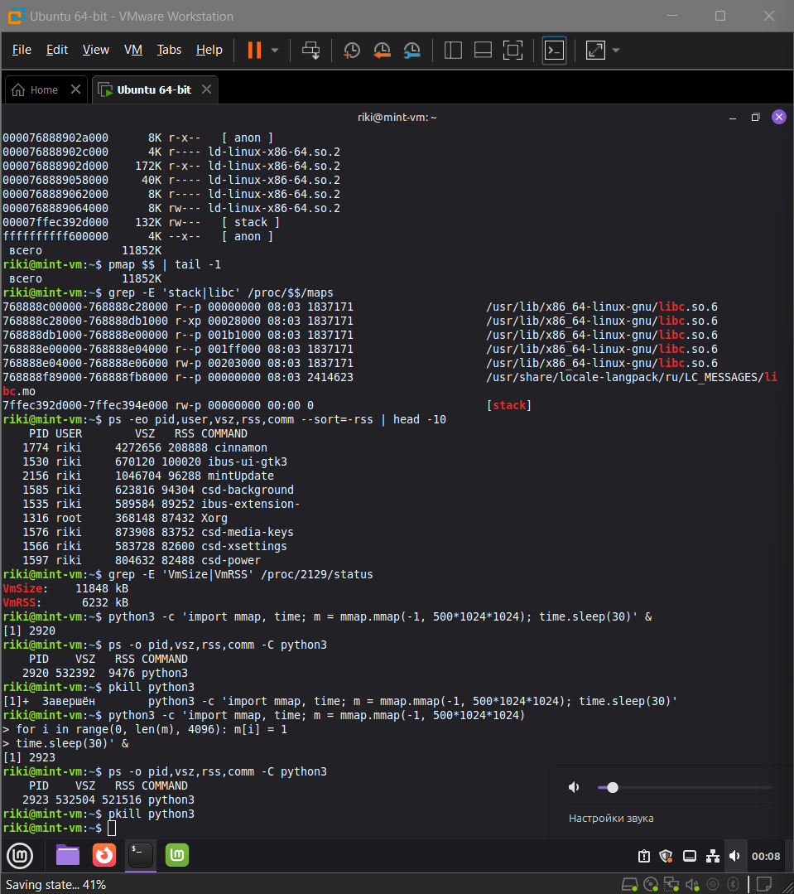

Задание 1. Карта памяти процесса

1. Фрагмент карты памяти и разбор областей

Я использовал команду pmap $$ для просмотра карты памяти текущей оболочки (bash, PID 2129) в читаемом виде:text
2129: bash
000058146eaf5000 192K r---- bash
000058146eb25000 956K r-x-- bash
...
0000581489050000 1188K rw--- [ anon ]
0000768888c00000 160K r---- libc.so.6
0000768888c28000 1572K r-x-- libc.so.6
...
00007ffec392d000 132K rw--- [ stack ]
ffffffffff600000 4K --x-- [ anon ]
всего 11852K

Разбор видимых областей:
- Код оболочки (bash): области с правами r-x-- (чтение и исполнение), например, 000058146eb25000. Здесь хранится исполняемый код программы.
- Библиотеки (libc.so.6, libtinfo.so.6.4): отображаются несколько раз с разными правами. Например, r-x-- для исполняемого кода библиотеки и r---- для данных только для чтения. Это стандартное разделение сегментов.
- Куча ([heap]): область rw--- (чтение и запись), используемая для динамического выделения памяти (например, через malloc). В моём выводе это 0000581489050000.
- Стек ([stack]): область rw--- в самом верху виртуального адресного пространства (адрес 7ffec392d000). Используется для хранения локальных переменных функций и адресов возврата.

Общий размер, показанный pmap: 11852K (около 11.5 МБ виртуальной памяти).

2. Ответ на контрольный вопрос

Почему одна и та же библиотека libc присутствует в памяти десятков процессов, но в ОЗУ лежит в одном экземпляре?

Это достигается благодаря механизму разделяемых библиотек (shared libraries) и аппарату MMU (Memory Management Unit). 
Когда несколько процессов загружают libc.so.6, их виртуальные адреса отображаются на одни и те же физические страницы оперативной памяти. Поскольку код библиотеки доступен только для чтения и исполнения (r-- и r-x), процессы не могут его изменить. 
Если бы какой-то процесс попытался записать в эту страницу, сработал бы механизм Copy-on-Write (CoW): ядро создало бы копию страницы только для этого процесса, а все остальные продолжили бы использовать общую оригинальную страницу. Это позволяет экономить гигабайты физической памяти (RAM) в системе.

