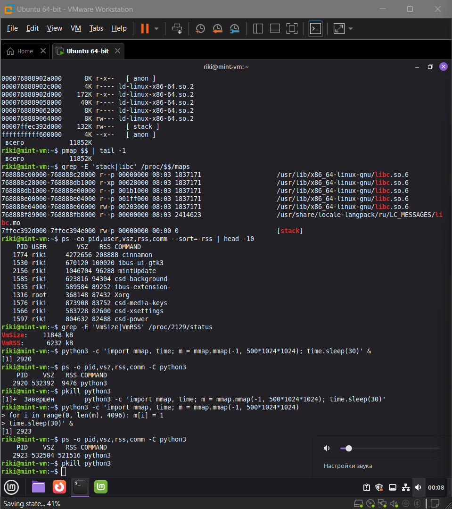

 Задание 2. RSS против VSZ

1. Общая картина потребления памяти

Команда ps -eo pid,user,vsz,rss,comm --sort=-rss | head -10 показывает, что у большинства процессов значение VSZ (виртуальный размер) в разы превышает RSS (реально занимаемую физическую память). Это нормальное поведение, так как процессы резервируют адресное пространство, но не всегда используют его полностью.

*(Здесь вставь вывод команды head -10, если он у тебя сохранился, или удали этот абзац)*

 2. Эксперимент с резервированием памяти (без записи)

Я запустил процесс Python, который резервирует 500 МБ через mmap, но не записывает в эту область ни байта:
``bash python3 -c 'import mmap, time; m = mmap.mmap(-1, 500*1024*1024); time.sleep(30)' & ps -o pid,vsz,rss,comm -C python3 Вывод     PID    VSZ   RSS COMMAND    2920 532392  9476 python3 **Анализ:** VSZ составил 532392 КБ (~520 МБ), что подтверждает запрос памяти. Однако RSS составил всего 9476 КБ (~9 МБ). Физическая память почти не была задействована. 

3. Эксперимент с реальной записью в память

Я завершил первый процесс (pkill python3) и запустил вариант, который принудительно записывает хотя бы один байт в каждую страницу (каждые 4096 байт):python3 -c 'import mmap, time; m = mmap.mmap(-1, 500*1024*1024);  for i in range(0, len(m), 4096): m[i] = 1 time.sleep(30)' & ps -o pid,vsz,rss,comm -C python3 Вывод     PID    VSZ   RSS COMMAND    2923 532504 521516 python3 **Анализ:** VSZ остался примерно тем же (~520 МБ), но **RSS вырос до 521516 КБ (~509 МБ)**. **4. Ответы на контрольные вопросы** **Почему у первого процесса RSS маленький, хотя VSZ большой?** Когда процесс вызывает mmap` для резервирования памяти, операционная система лишь выделяет ему диапазон в виртуальном адресном пространстве (что и отражается в VSZ). Однако физические страницы оперативной памяти (RAM) не выделяются до тех пор, пока процесс не попытается прочитать или записать данные по этим адресам. Это механизм экономии ресурсов.
Как это связано с принципом «выделено ≠ занято» из лекции? Этот эксперимент является прямой иллюстрацией данного принципа.
Выделено (VSZ) — это обещание операционной системы предоставить память в будущем.
Занято (RSS) — это фактическое выделение физических страниц RAM, которое происходит по принципу Copy-on-Write или при первом обращении (page fault). Пока процесс не трогает зарезервированные страницы, они остаются «пустыми» и не съедают реальную оперативную память системы.
