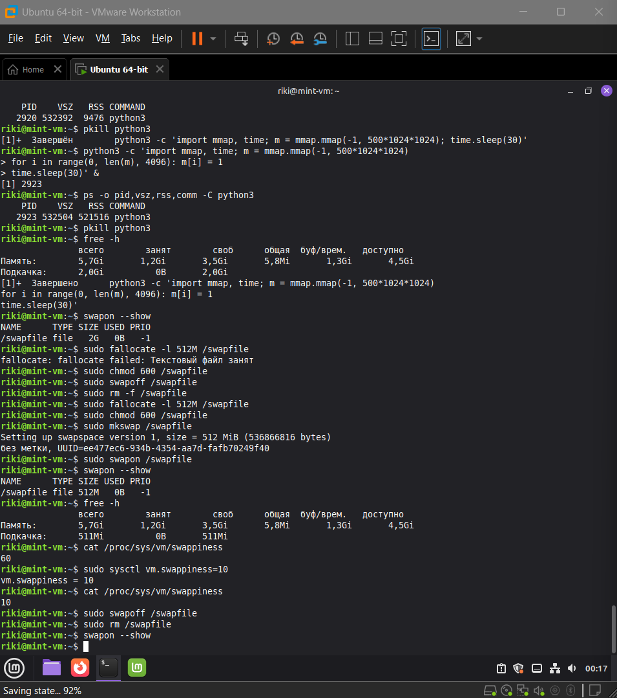

 Задание 3. Настройка подкачки
 
 1. Создание и подключение файла подкачки

Я создал файл подкачки размером 512 МБ и подключил его к системе, выполнив последовательность команд:
1. sudo fallocate -l 512M /swapfile — мгновенно резервирует место на диске под файл заданного размера.
2. sudo chmod 600 /swapfile — устанавливает строгие права доступа (чтение и запись только для root), что является требованием безопасности для swap-файлов.
3. sudo mkswap /swapfile — форматирует файл, создавая в нём структуру данных, необходимую ядру для использования его как области подкачки.
4. sudo swapon /swapfile — активирует файл и добавляет его в пул доступной виртуальной памяти системы.

После этого команда swapon --show подтвердила, что файл /swapfile размером 512M успешно подключен.

2. Изменение параметра swappiness

Я проверил и изменил параметр, регулирующий склонность ядра использовать swap:
``bash cat /proc/sys/vm/swappiness # Вывод: 60 sudo sysctl vm.swappiness=10 # Вывод: vm.swappiness = 10 cat /proc/sys/vm/swappiness # Вывод: 10 **Что такое swappiness и разница между 60 и 10:** Параметр vm.swappiness принимает значения от 0 до 100 и определяет, насколько агрессивно ядро будет вытеснять страницы из оперативной памяти (RAM) в swap. Значение **60** (стандарт для Ubuntu/Mint) означает сбалансированный подход: ядро начинает активно использовать swap, когда свободно около 40% RAM. Значение **10** говорит ядру: «Используй swap только в самом крайнем случае, когда свободной оперативной памяти остаётся критически мало (около 90% занято)». Это предпочтительно для систем с достаточным объёмом RAM, чтобы избежать лишнего дискового ввода-вывода. 

3. Ответ на контрольный вопрос

 Почему для сервера базы данных swap иногда рекомендуют вовсе отключать?
 
 Базы данных (например, PostgreSQL или MySQL) самостоятельно управляют своими кэшами в оперативной памяти для максимальной производительности. Если ядро начнёт вытеснять страницы памяти БД в медленный swap (даже при значении swappiness=10 в условиях нехватки памяти), это приведёт к резким скачкам задержек (латентности) при дисковых операциях, так как БД будет пытаться обратиться к данным, которые физически находятся на диске в swap-файле. Это явление называется **thrashing (пробуксовка)**. Поэтому на выделенных серверах БД swap часто отключают полностью (swapoff -a`), а нехватку памяти контролируют через OOM-killer или лимиты cgroups, чтобы избежать катастрофической деградации производительности.
 
 4. Очистка после эксперимента

Для возврата системы в исходное состояние я отключил и удалил файл подкачки:sudo swapoff /swapfile
sudo rm /swapfile
swapon --show
Последняя команда не вернула никакого вывода, что подтверждает успешное отключение и удаление файла подкачки.
