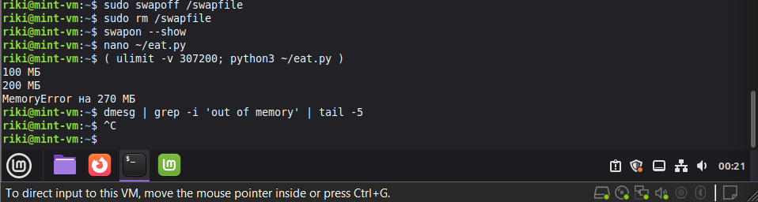

Задание 4. Нехватка памяти и OOM Killer

 1. Эксперимент с ограничением памяти

Я запустил скрипт ~/eat.py, который пытается выделить память блоками по 10 МБ, но с жёстким ограничением виртуальной памяти в 300 МБ (307200 КБ) с помощью ulimit:

``bash ( ulimit -v 307200; python3 ~/eat.py ) Вывод 100 МБ 200 МБ MemoryError на 270 МБ **2. Проверка логов ядра** Я проверил системный журнал на наличие записей от OOM Killer:dmesg | grep -i 'out of memory' | tail -5 **Вывод:** (пустой, команда ничего не вернула). **Почему записей нет:** Это нормальное и ожидаемое поведение. Процесс был завершён не ядром (OOM Killer), а собственным лимитом ulimit. Когда виртуальная память процесса достигла заданного предела (около 270–300 МБ с учётом накладных расходов самого интерпретатора Python), система просто отказала в выделении следующей страницы, и Python корректно выбросил исключение MemoryError. Ядро при этом не испытывало нехватки памяти и не вмешивалось. 

3. Ответы на контрольные вопросы
  
Что делает ulimit -v и почему этот способ безопаснее запуска без лимита?

Команда ulimit -v устанавливает максимальный размер виртуальной памяти (в килобайтах), который может выделить __текущий процесс и его потомки__. Это безопасно, потому что ограничение действует только на одну конкретную оболочку/процесс. Если процесс попытается превысить лимит, он просто завершится с ошибкой, не затрагивая работу всей операционной системы и не вызывая зависаний. Запуск такого скрипта без ulimit привёл бы к исчерпанию всей оперативной памяти и swap, после чего система начала бы агрессивно убивать процессы (включая графический интерфейс), что могло бы привести к зависанию виртуальной машины.

Как ядро выбирает жертву, когда память кончается у всей системы?

Когда свободной памяти (RAM + swap) критически мало, ядро вызывает механизм OOM (Out-Of-Memory) Killer. Он вычисляет для каждого процесса специальный показатель oom_score. Жертвой выбирается процесс с **наивысшим** значением oom_score. Алгоритм учитывает: Объём потребляемой процессом памяти (чем больше ест, тем выше шанс быть убитым). Время жизни процесса (долгоживущие процессы получают небольшой бонус к выживанию). Приоритет процесса (процессы с повышенным приоритетом или принадлежащие root защищаются лучше). Ручную поправку oom_score_adj.

Что такое oom_score и где его посмотреть?

oom_score` — это числовое значение (от 0 до 1000), которое отражает "жертвенность" процесса. Чем оно выше, тем вероятнее, что OOM Killer выберет этот процесс для уничтожения при нехватке памяти. Посмотреть его можно в виртуальной файловой системе:
