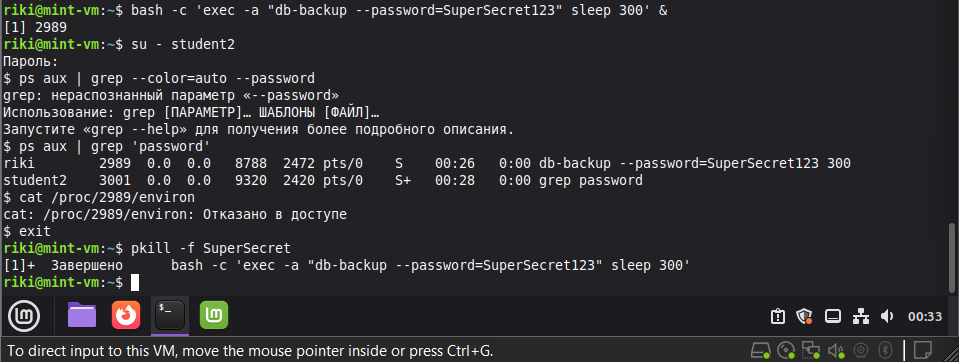

Задание 5. Пароль на виду

1. Эксперимент: пароль в аргументах команды

Я запустил процесс, имитирующий утилиту резервного копирования, передав пароль прямо в аргументах командной строки:
``bash bash -c 'exec -a "db-backup --password=SuperSecret123" sleep 300' & Затем я переключился на второго пользователя (su - student2) и выполнил поиск: ps aux | grep 'password' вывод riki        2989  0.0  0.0   8788  2472 pts/0    S    00:26   0:00 db-backup --password=SuperSecret123 300 student2    3001  0.0  0.0   9320  2420 pts/0    S+   00:28   0:00 grep password **Результат:** Пользователь student2 увидел чужой процесс и **полный текст пароля** (SuperSecret123), хотя процесс принадлежит пользователю riki. 

2. Попытка прочитать переменные окружения
  
От имени student2 я попытался прочитать файл окружения этого процесса:cat /proc/2989/environ Вывод cat: /proc/2989/environ: Отказано в доступе 

3. Ответы на контрольные вопросы

 Почему cmdline доступен всем, а environ — нет?

Ядро Linux намеренно делает файл /proc/PID/cmdline доступным для чтения всем пользователям (права -r--r--r--). Это нужно для того, чтобы системные администраторы и обычные пользователи могли видеть, какие именно программы и с какими параметрами запущены в системе (например, чтобы найти зависший процесс). Побочный эффект этого решения: любые секреты, переданные как аргументы (пароли, токены), становятся публичными. Файл /proc/PID/environ, напротив, защищён правами -r-------- (чтение только для владельца процесса и root). Ядро ограничивает доступ к нему, потому что переменные окружения часто содержат конфиденциальные данные (например, DB_PASSWORD), и их утечка была бы критичной.

Как правильно передавать пароль программе?
Передавать пароль аргументом командной строки**категорически нельзя**. Правильные способы: **Интерактивный ввод:** Программа сама запрашивает пароль при запуске (как это делает ssh или sudo). В этом случае символы не отображаются и не сохраняются в истории команд. **Файл конфигурации:** Пароль хранится в скрытом файле (например, ~/.myapp_config) со строгими правами доступа chmod 600 (только владелец может читать и писать). **Переменные окружения (с осторожностью):** Передача через ENV, но только если приложение умеет их читать, и только в рамках изолированного окружения (например, Docker-контейнера), так как environ всё же защищён лучше, чем cmdline.

4. Завершение эксперимента

 Вернувшись к пользователю riki`, я завершил процесс: pkill -f SuperSecret
