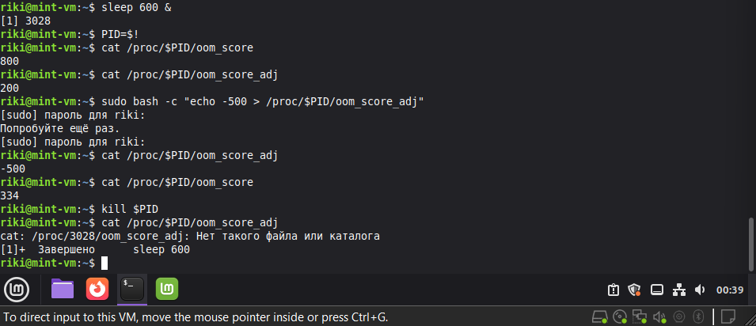

Задание 6. Защита важной службы от OOM

1. Эксперимент с oom_score и oom_score_adj

Я запустил фоновый процесс и изучил его "жертвенность" для OOM Killer:

``bash sleep 600 & PID=$! cat /proc/$PID/oom_score cat /proc/$PID/oom_score_adj # Задание 6. Защита важной службы от OOM **Вывод до изменения:**800 ; 200 Затем я понизил жертвенность процесса, установив oom_score_adj в -500: sudo bash -c "echo -500 > /proc/$PID/oom_score_adj" cat /proc/$PID/oom_score_adj cat /proc/$PID/oom_score **Вывод после изменения:** -500 334 

2. Анализ результатов

 **Как изменилась оценка:**oom_score_adj изменился с **200** на **-500** (ручная поправка, которую задал администратор).oom_score (итоговая оценка, которую использует OOM Killer) упал с **800** до **334**. Это означает, что процесс стал **менее чем в 2.5 раза менее вероятной жертвой** при нехватке памяти. OOM Killer теперь будет выбирать другие процессы с более высоким oom_score раньше, чем этот. **Зачем понадобился sudo:** Файлы /proc/PID/oom_score_adj принадлежат root и имеют права -rw-r--r-- (запись только для владельца, то есть root). Обычный пользователь не может изменять параметры, влияющие на поведение ядра при нехватке памяти, так как это могло бы позволить ему защитить свои процессы от OOM Killer в ущерб системным службам. 
 
 3. Пример из реальной жизни
  
    На реальном сервере я бы понизил oom_score_adj для **процесса базы данных** (например, PostgreSQL или MySQL), потому что: Потеря БД означает потерю или повреждение бизнес-критичных данных. БД обычно занимает много памяти, и без защиты OOM Killer мог бы выбрать её жертвой просто из-за большого oom_score. Перезапуск БД после убийства занимает много времени и требует проверки целостности данных. Также важно защищать **SSH-демон (sshd)**, чтобы администратор не потерял доступ к серверу при нехватке памяти.

4. Завершение эксперимента

 Я завершил процесс и убедился, что его запись в /proc` удалена:kill $PID
cat /proc/$PID/oom_score_adj

Вывод cat: /proc/3028/oom_score_adj: Нет такого файла или каталога
[1]+  Завершено      sleep 600
Это подтверждает, что процесс корректно завершён и ядро очистило все связанные с ним структуры данных.
